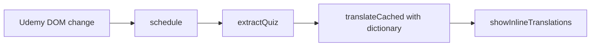

# Architecture Overview

## Files
- `manifest.json` — Manifest V3. Injects the content script into Udemy pages in the `MAIN` world.
- `dictionary-terms.js` — Developer term list, loaded first. Sets `window.__udemyQuizTranslatorTerms`.
- `dictionary.js` — Builds the term matcher. Sets `window.__udemyQuizTranslatorDictionary` (`protect`, `restore`).
- `content.js` — Single IIFE. Detects the quiz, translates it with the Chrome Translator API, and renders the result.

## Translation Flow
A `MutationObserver` watches the Udemy page. On change, `update()` extracts the
current quiz, translates the question and each answer, and inserts the Japanese text
next to the original elements: to the right when there is room, otherwise below. There is no panel or button on the page.

Scenario:
- Input: User moves from Question 3 to Question 4
- Steps: Observer fires → `extractQuiz()` returns question 4 → translated → old inline nodes removed, new ones inserted
- Result: Japanese text for question 4 appears under the original question and each answer

## Modules Inside content.js
- Startup — `autoStart()`, `startOnFirstGesture()`, `initialize()`; see [Startup](../design/translation/10-startup.md)
- Inline rendering — `showInlineTranslations()`, `shiftForSide()`, `showSideTranslations()`, `positionSide()`, `clearInlineTranslations()`; see [Inline Translation](../design/quiz/10-inline-translation.md)
- Extraction — `extractQuiz()`, `cardOf()`, `originalInnerText()`
- Translation — `translateCached()`, `translateWithDictionary()`; see [Dictionary](../design/translation/20-dictionary.md)
