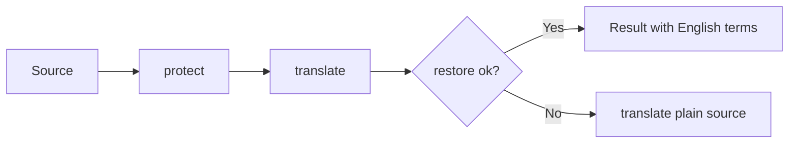

# Dictionary Design

## Placeholder Substitution
- Input: Source English text
- Output: Japanese translation with dictionary terms in their original English form
- Code: `dictionary.js` → `protect()`, `restore()`; `content.js` → `translateWithDictionary()`
- Data: `dictionary-terms.js` → `window.__udemyQuizTranslatorTerms`
- Spec: [Dictionary](../../specs/translation/20-dictionary.md#requirements)
- Architecture: [Overview](../../architecture/10-overview.md#translation-flow)

Steps:
1. `protect()` replaces each term with `[[n]]`, in text order, and returns the original surface texts
2. The translator translates the text with placeholders
3. `restore()` puts the terms back. Extra brackets the translator adds (`[[[0]]`) are absorbed
4. If any placeholder is missing, `restore()` returns `null` and the plain source is translated instead

Representative scenario:
- Input: "Launch an EC2 instance in a private subnet with an IAM role."
- Steps: `protect()` → "Launch an [[0]] [[1]] in a [[2]] with an [[3]]." → translate → `restore()`
- Result: "IAM roleを使ってprivate subnetでEC2 instanceを起動します。"
- All scenarios: [Dictionary Scenarios](../../testing/scenarios/translation/20-dictionary.md#dictionary-scenarios)

## Placeholder Format
`[[n]]` was chosen after testing on Chrome 157 with English → Korean: it survived 15 tokens in a long text. English → Japanese has not been tested yet. `X0X` and `ZQ0ZQ` were lowercased, and `⟦n⟧` was corrupted. Source text that already contains `[[n]]` is translated without the dictionary.

## Matching
- One regex for all terms, sorted longest first
- Case-insensitive terms use the inline `(?i:...)` modifier (Chrome 125+; the extension requires 138+)
- Terms without lowercase letters and the `caseSensitive` list match exactly
- Boundaries: no letter, digit, or `_` on either side; spaces in a term match any whitespace
- A trailing `s`/`es` is matched after a term ending in a letter

## Term File Layout
`dictionary-terms.js` has `caseSensitive` (product names that are ordinary words in lowercase) and `groups` (`claude`, `awsServices`, `awsConcepts`, `ccarF`, `general`). `ccarF` is organized by the five CCAR-F exam domains. Adding a term means adding a string to a group. Avoid everyday English words such as "object", "request", "continue", or "summary", which would stay untranslated everywhere. Add inflected forms that are not plurals explicitly ("deterministically").

## Known Limits
Japanese particles (は, が, を) do not depend on the preceding word's pronunciation, so restoring an English term does not create the particle mismatch the Korean version had. Whether the translator keeps placeholders as reliably in Japanese is not yet verified.
